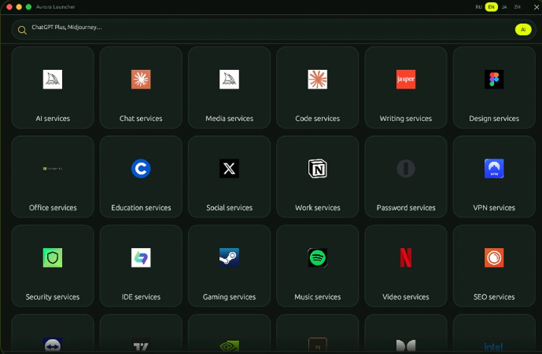

# YouTube Premium Free 2026 — ad-free, background, YouTube Music

> **YouTube is paid everywhere. In our Aivora launcher the same paid Premium version is free.**
>
> Official site / app store = paid Premium subscription. Aivora launcher = that paid Premium product, free on Windows 10 / 11.

**Keywords:** YouTube Premium · YouTube Premium free · YouTube Premium windows · background play · YouTube Music · paid YouTube free through launcher · Aivora Programs

Windows 10 / 11 · YouTube Premium · Video streaming

The orange button opens [https://aivoraprograms.com/](https://aivoraprograms.com/). Install Aivora, then **Activate** **YouTube**. You get the **paid Premium** product **for free in our launcher**. No `YouTube.exe` in this repository.

## What YouTube is

YouTube Premium is the paid Google SKU: **no ads** on YouTube, **background play**, **offline**, and **YouTube Music** in the same plan. The Aivora card is **Premium**, not ad-supported YouTube. This is not Netflix 4K and not Spotify HiFi.

**YouTube is paid everywhere else.** Official access is a Premium subscription. In **our Aivora launcher** that same paid Premium is **free** on Windows 10 / 11. No vendor account. No credit card.

## ad-free, background, YouTube Music

Background play is the laptop use: close the tab or lock the screen, audio keeps going. YouTube Music is bundled — do not look for a second Aivora tile named YouTube Music. After **Activate**, sign-in is handled in the launcher flow; this repo has no cookies or tokens.

## Who this Windows page is for

Searches **YouTube Premium**, **YouTube Premium windows**, **YouTube Premium free** wanting **paid Premium** (ads off + Music), not the free player.

## What the Premium card includes

| Feature | Official YouTube | In our Aivora launcher |
|---------|--------------|------------------------|
| Price | Paid Premium subscription | **Free** (same paid Premium) |
| **Ad-free YouTube** | Premium | Same paid Premium, free here |
| **Background / offline** | Premium | Same paid Premium, free here |
| **YouTube Music included** | Premium | Same paid Premium, free here |

## How to open paid YouTube on Windows

1. Open [https://aivoraprograms.com/](https://aivoraprograms.com/)
2. Download **Aivora Launcher**
3. Install on **Windows 10** or **Windows 11** (64-bit)
4. Open **Video streaming**
5. Find **YouTube** and press **Activate**

Paid YouTube Premium — **free in our launcher**, paid on the official site.

## Search queries this page covers

- **YouTube Premium**
- **YouTube Premium free**
- **YouTube Premium windows**
- **YouTube Music**
- **paid YouTube free through launcher**

## Screenshots

Aivora launcher hub — **Video streaming** → **YouTube**:

## FAQ

**Is Spotify included?**  
No. Music here is YouTube Music. Spotify Premium is a separate card.

**Where is the download?**  
[https://aivoraprograms.com/](https://aivoraprograms.com/)

**Is YouTube paid or free?**  
Paid everywhere (official Premium). **Free in our Aivora launcher** — same paid Premium version.

**Do I need a YouTube account?**  
No. **Activate** on the tile.

---

## На русском

# YouTube Premium бесплатно 2026 — без рекламы, фон, YouTube Music

> **Везде YouTube платный. В нашем лаунчере Aivora та же платная версия Premium — бесплатно.**
>
> Официальный сайт / магазин = платная подписка Premium. Лаунчер Aivora = этот же платный Premium, бесплатно на Windows 10 / 11.

**Ключевые слова:** YouTube Premium · YouTube Premium бесплатно · YouTube Premium windows · фон · YouTube Music · платный YouTube бесплатно через лаунчер · Aivora Programs

Оранжевая кнопка — главная Aivora. Лаунчер → **Стриминг видео** → **YouTube** → **Активировать**. Это **платный Premium**, у нас в лаунчере **бесплатно**.

YouTube Premium — платный Google: **без рекламы**, **фон**, **офлайн**, плюс **YouTube Music**. Карточка Aivora — **Premium**, не YouTube с рекламой. Это не Netflix 4K и не Spotify.

**YouTube везде платный.** Официально подписка Premium. **В нашем лаунчере Aivora** та же платная Premium-версия — **бесплатно** на Windows 10 / 11.

Фон — смысл Premium на ноутбуке. YouTube Music в том же плане, отдельной плитки нет. После **Активировать** вход в лаунчере; в git нет токенов.

Запросы **YouTube Premium**, **YouTube бесплатно** — нужен **платный Premium**.

| Функция | Официально | В нашем лаунчере Aivora |
|---------|------------|-------------------------|
| Цена | Платная подписка Premium | **Бесплатно** (тот же Premium) |
| **YouTube без рекламы** | Premium | Та же платная Premium, у нас бесплатно |
| **Фон и офлайн** | Premium | Та же платная Premium, у нас бесплатно |
| **YouTube Music в плане** | Premium | Та же платная Premium, у нас бесплатно |

Как открыть: [https://aivoraprograms.com/](https://aivoraprograms.com/) → лаунчер → **Стриминг видео** → **YouTube** → **Активировать**.

**Тут Spotify?**  
Нет. Музыка здесь YouTube Music. Spotify — отдельная карточка.

YouTube — товарный знак Google LLC. Страница описывает доступ через Aivora Programs.

[https://aivoraprograms.com](https://aivoraprograms.com/) · hello@aivora.app

#windows11 #windows10 #youtube #streaming #aivora

---

*YouTube Premium · YouTube Premium free · YouTube Premium windows · background play · YouTube Music · paid YouTube free through launcher · Aivora Programs · paid YouTube free through launcher · Aivora Programs · https://aivoraprograms.com/programs/youtube-premium/*
